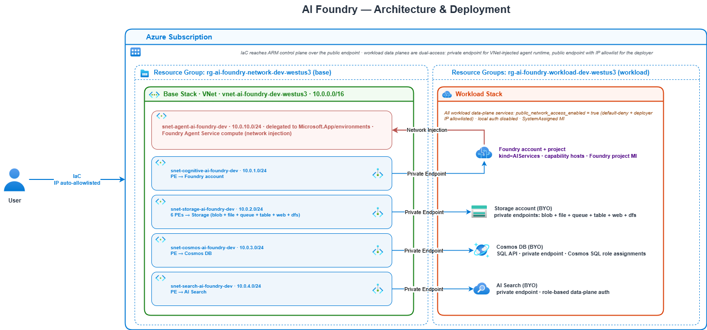

# AI Foundry Private Networking Lab

Foundry Agent Service in Standard Setup on a private network. Your own Storage account, Cosmos DB, and AI Search hold the agent data, and Foundry reaches them through private endpoints and managed-identity connections.

The layout follows the [Cloud Adoption Framework landing-zone pattern](https://learn.microsoft.com/azure/cloud-adoption-framework/ready/landing-zone/design-area/network-topology-and-connectivity). Networking (VNet, subnets, private DNS zones) lives in one resource group and the workload in another, the way a platform team and an application team split ownership.

The same architecture is implemented twice. Pick one path. Don't run both against the same resource groups, because they use the same resource names.

| Path | Code | State |
|---|---|---|
| [Path A — Bicep](#path-a--bicep) | [`base/bicep/`](base/bicep/), [`workload/bicep/`](workload/bicep/) | None; ARM keeps the deployment history |
| [Path B — Terraform](#path-b--terraform) | [`base/terraform/`](base/terraform/), [`workload/terraform/`](workload/terraform/) | Remote `azurerm` backend in a Storage account that `az` creates and Terraform then manages |

Every command is PowerShell 7. Multi-line blocks are wrapped in `. { … }`, so each one pastes and runs as a single unit and its variables stay in your session.

## Contents

- [Architecture](#architecture)
- [Prerequisites](#prerequisites)
- [Before you deploy](#before-you-deploy): public or private path, regions, existing networking
- [Session helpers](#session-helpers)
- [Path A — Bicep](#path-a--bicep)
- [Path B — Terraform](#path-b--terraform)
- [Verify the deployment](#verify-the-deployment)
- [After you deploy](#after-you-deploy): new terminal, redeploy, move a service, harden
- [Tear down](#tear-down)
- [RBAC roster](#rbac-roster)
- [Troubleshooting](#troubleshooting)
- [References](#references)

## Architecture



Source: [`assets/architecture.drawio`](assets/architecture.drawio). Path B also creates a Terraform-state Storage account, with a blob private endpoint, in the networking resource group. It isn't in the diagram.

| Stack | Resource group (default) | Contents |
|---|---|---|
| Base | `rg-ai-foundry-network-dev-westus3` | VNet `10.0.0.0/16` with 4 private-endpoint subnets and 1 agent subnet delegated to `Microsoft.App/environments`; 11 private DNS zones linked to the VNet |
| Workload | `rg-ai-foundry-workload-dev-westus3` | Foundry account (`AIServices`, injected into the agent subnet) and project; Storage account, Cosmos DB (NoSQL), and AI Search (`standard`); 9 private endpoints; 3 Entra ID connections, the capability hosts, and the project identity's [role assignments](#rbac-roster) |

Every service has key-based auth disabled and uses a system-assigned managed identity. Public network access stays enabled behind a default-deny firewall that allows only your IP, so you can manage the lab from your machine. [Harden](#harden) closes it.

### DNS zones and private endpoints

The base stack creates the zones and links them to the VNet before the workload creates its private endpoints, so each endpoint's DNS record registers automatically. Zone names follow Microsoft's [private endpoint DNS table](https://learn.microsoft.com/azure/private-link/private-endpoint-dns).

| Service | Sub-resource | Private DNS zone |
|---|---|---|
| Foundry account | `account` | `privatelink.cognitiveservices.azure.com`, `privatelink.openai.azure.com`, `privatelink.services.ai.azure.com` (all three are required) |
| Storage account | `blob`, `file`, `queue`, `table`, `dfs`, `web` | `privatelink.<sub-resource>.core.windows.net` (6 zones) |
| Cosmos DB | `Sql` | `privatelink.documents.azure.com` |
| AI Search | `searchService` | `privatelink.search.windows.net` |

- **Sovereign clouds (Azure Government, China):** these are Azure public cloud names, and the base stacks create them as listed. Create and link your cloud's zones yourself, attach to them as [existing networking](#existing-byo-networking), and override the zone names for the workload.
- **Storage endpoints:** Agent Service uses only `blob`. The other 5 endpoints cost about $35 a month. They let File, Queue, Table, ADLS Gen2, or static websites work later without network changes. To drop them, remove their zone IDs from the storage module call in the workload's `main.bicep` or `main.tf`.

## Prerequisites

- **PowerShell 7+ and a clone of this repo.** Run the commands from inside the clone; they locate files with `git rev-parse --show-toplevel`. Use one terminal for a whole run, because the steps share session variables. For a new terminal, see [New terminal or redeploy](#new-terminal-or-redeploy).
- **Azure CLI** 2.60+ ([install](https://learn.microsoft.com/cli/azure/install-azure-cli)).
  - Path A also needs **Bicep** 0.30+ (`az bicep upgrade`).
  - Path B needs **Terraform** 1.7.5+ ([install](https://developer.hashicorp.com/terraform/install)).
- **Outbound HTTPS to `api.ipify.org`** to detect your public IP.
- **Permissions:** `Owner` on the subscription is simplest. For least privilege:

| Role | Scope | Why |
|---|---|---|
| Contributor | Subscription. Once the providers are registered, the resource groups the lab creates are enough. | Register resource providers and create every resource |
| User Access Administrator or Role Based Access Control Administrator | Workload resource group; for Path B also `$RG_NETWORK` | Create the 6 role assignments for the project identity. Path B also gives you a blob role on the Terraform-state account. |
| Network Contributor, or any role with `Microsoft.Network/virtualNetworks/subnets/join/action` | The VNet's resource group, if you attach to [existing networking](#existing-byo-networking) | Place the private endpoints and the agent runtime in its subnets |
| Private DNS Zone Contributor | The DNS zones' resource group, if the lab doesn't create it | Link the workload's private endpoints to the zones |

The Cosmos DB SQL role assignment is a Cosmos DB resource, not an Azure role assignment. Contributor covers it. The built-in Cosmos DB Operator role and the two RBAC roles above don't.

## Before you deploy

### Public path or private path

Each service's public endpoint stays enabled behind a default-deny firewall. The deploy works either way, because ARM and the resource providers do the work through the trusted-services bypass. What you do afterwards from your machine is different. The Foundry portal, the SDKs, `az storage blob`, and `az cosmosdb sql` all go to the public endpoint, unless your machine resolves the services to their private endpoints.

| | Public path (default) | Private path |
|---|---|---|
| Your machine | On the internet | Reaches the VNet (VPN, ExpressRoute, Bastion, or a runner inside it) and resolves `privatelink.*` through Azure DNS, directly or through a forwarder to `168.63.129.16` |
| Firewall allowlist | Your public IP | Empty |
| Path A | `$DEPLOYER_IP` is your IP (the Step 1 default) | Set `$DEPLOYER_IP = ""` |
| Path B | Terraform detects your IP | Add `-var 'deployer_ip='` to the workload apply |

Choose the private path only if your machine is on a network connected to the VNet and your platform team confirms that `privatelink.*` resolves through Azure DNS. Client-side DNS checks can mislead (split tunnels, NRPT rules). Otherwise use the public path; switching later is a redeploy. After the deploy, [check](#verify-the-deployment) that the Foundry endpoint resolves privately. [Harden](#harden) once you no longer need access from your machine.

### Regions

The Foundry account, the VNet, and all 9 private endpoints share one region, `$LOC` in Step 1 (default `westus3`). Two Microsoft rules require this:

- the [Agent Service networking docs](https://learn.microsoft.com/azure/ai-foundry/agents/how-to/virtual-networks#limitations): "The Foundry resource must be deployed in the same region as the virtual network";
- a [private endpoint](https://learn.microsoft.com/azure/private-link/private-endpoint-overview) must be in its VNet's region.

Check that the region is [supported for Agent Service private networking](https://learn.microsoft.com/azure/ai-foundry/agents/concepts/limits-quotas-regions#supported-regions).

The same docs say "Other Azure resources, such as Azure Cosmos DB, Azure AI Search, and Azure Storage, can be deployed in different regions". That helps when the Foundry region has no capacity for one of them, or a policy pins data elsewhere. Their private endpoints still stay in the VNet's region.

| Service | Path A (Step 1) | Path B (`terraform.tfvars`) | Default |
|---|---|---|---|
| Storage | `$LOC_STORAGE` | `storage_location` | `$LOC` |
| Cosmos DB | `$LOC_COSMOS` | `cosmos_location` | `$LOC` |
| AI Search | `$LOC_SEARCH` | `ai_search_location` | `$LOC` |

- **Decide before the first workload deploy.** A deployed service can't change region in place, and [moving one](#move-a-service-to-another-region) recreates it empty.
- **Use programmatic region names** (`eastus2`, not `East US 2`). The [preflight check](#session-helpers) confirms each region offers the service, that your subscription may create Cosmos DB accounts there, and that AI Search quota is left.
- **Cost and latency.** Agent traffic to a service in another region crosses regions: you pay inter-region data transfer on top of private endpoint charges, plus the extra round trip.
- **Default names follow each service's region.** They are `st<baseName><environment><region>` (hyphens stripped, 24 characters max), `cosmos-<baseName>-<environment>-<region>`, and `srch-<baseName>-<environment>-<region>`. With the default `ai-foundry` / `dev`, a Storage region longer than 10 characters (for example `swedencentral`) needs an explicit name: `$STORAGE_NAME` (Path A) or `storage_account_name` (Path B).
- **Path B: keep `workload/terraform/terraform.tfvars`.** Every later plan, apply, and destroy must read the same regions. `terraform output` shows them.

### Existing (BYO) networking

The workload finds the VNet, subnets, and DNS zones **by name**, using Bicep `existing` and Terraform `data` sources. That means it can attach to any network that has them: a platform team's spoke, DNS zones in a hub, or this lab's base stack. To list an existing VNet's names:

```powershell
az network vnet list -g "<vnet-resource-group>" --query "[].{VNet:name, Region:location, Subnets:join(', ', subnets[].name)}" -o table
```

The network needs:

- 4 subnets for private endpoints (`/24` is plenty) and 1 subnet delegated to `Microsoft.App/environments` for the agent runtime;
- the 11 private DNS zones linked to the VNet **before** the workload deploy, so that the endpoints' DNS records register;
- the VNet in `$LOC`, and in the workload's subscription.

If the zones are in another resource group, you need Private DNS Zone Contributor there ([Prerequisites](#prerequisites)).

Step 2 creates resource groups only if they're missing, so it doesn't re-tag yours, and [Tear down](#tear-down) marks the steps to skip with existing networking. To attach to existing networking:

- **Path A:** in Step 1, set `$RG_NETWORK` to the VNet's resource group, plus `$RG_DNS`, `$SUB_DNS`, and the names. Skip Step 3 (base). When you tear down, delete only the workload resource group.
- **Path B:** in Step 1, set `$RG_VNET` to the VNet's resource group, plus `$RG_DNS` and the names. Keep `$RG_NETWORK` as a resource group of your own, because it holds the Terraform-state account. Skip Step 4 (base).

| Setting | Path A (Bicep) | Path B (Terraform) | Default |
|---|---|---|---|
| VNet's resource group | `$RG_NETWORK` | `$RG_VNET` (`$RG_NETWORK` holds the state account) | `rg-ai-foundry-network-dev-<region>` |
| Workload resource group | `$RG_WORKLOAD` | Same (Step 1) | `rg-ai-foundry-workload-dev-<region>` |
| DNS zones' resource group / subscription | `$RG_DNS` / `$SUB_DNS` | `$RG_DNS` (same subscription only) | VNet's resource group / current subscription |
| VNet and subnet names | `$VNET_NAME`, `$SUBNET_*` | Same (Step 1) | `vnet-ai-foundry-dev-<region>`, `snet-<purpose>-ai-foundry-dev` |
| Foundry account name / custom subdomain | `$COGNITIVE_ACCOUNT_NAME` / `$COGNITIVE_SUBDOMAIN` | Derived / `cognitive_custom_subdomain_name` | `ais-ai-foundry-dev-<region>` / `cog-acc-ai-foundry-dev-<region>` |
| Storage, Cosmos DB, AI Search names | `$STORAGE_NAME`, `$COSMOS_NAME`, `$AI_SEARCH_NAME` | `storage_account_name`; Cosmos DB and AI Search are derived | Derived from each service's region |
| Private DNS zone names | `-p cognitivePrivateDnsZoneNames=…`, `storagePrivateDnsZoneNames`, `cosmosPrivateDnsZoneName`, `searchPrivateDnsZoneName` | `cognitive_private_dns_zone_names`, `storage_private_dns_zone_names`, `cosmos_private_dns_zone_name`, `search_private_dns_zone_name` | Azure public cloud |
| Naming prefix (derived names, tags) | `-p baseName=… environment=…` | `base_name`, `environment` | `ai-foundry`, `dev` |

- **Path A** passes the Step 1 variables on every deploy. Add anything else as `-p name=value` to the Step 4 command.
- **Path B** passes the Step 1 variables as `-var` flags, which override `terraform.tfvars`. Put everything else in `workload/terraform/terraform.tfvars`; start from [`terraform.tfvars.example`](workload/terraform/terraform.tfvars.example). Terraform can't override the Foundry account, Cosmos DB, or AI Search names. On a global-name collision, edit the module's derived-name locals.

## Session helpers

Paste this block once per terminal, for either path. It only defines functions; it doesn't call Azure. Each function first checks that `az` is on `$SUBSCRIPTION_ID` from Step 1, so nothing lands in another subscription.

- **`Test-Preflight`** checks the regions before anything is created:
  - each region offers the Foundry account (`AIServices` `S0`), Container Apps (the agent runtime), Storage, Cosmos DB, and AI Search;
  - your subscription may create Cosmos DB accounts there;
  - AI Search `standard` quota is left.

  It can't check capacity, because Azure doesn't expose it, so a region can still run out during the deploy ([Troubleshooting](#troubleshooting)).
- **`Assert-BaseNetwork`** (Path A) stops a base deploy into a resource group that already holds a different VNet.
- **`Resolve-DataServiceVars`** (Path A) runs before every workload deploy.
  - It reads the Storage, Cosmos DB, and AI Search accounts the Foundry project actually uses, and puts their names and regions into your session. So a new terminal or a blank Step 1 value can't move, rename, or duplicate a deployed service.
  - It stops the deploy on any mismatch, ambiguity, or failed `az` call.

<details>
<summary><b>Session helpers</b> (expand, then copy the block)</summary>

```powershell
. {
    # Session helpers (both paths). This block only defines functions; paste it once per terminal.
    function ConvertTo-AzRegion([string] $Region) {
        # "West US 3" (how Cosmos DB reports its region) -> "westus3"
        ($Region -replace '\s', '').ToLowerInvariant()
    }

    function Invoke-AzJson {
        # Runs az with JSON output and parses it; throws with az's message if az fails.
        $out = & az @args -o json 2>&1
        if ($LASTEXITCODE -ne 0) { throw "az $($args -join ' ') failed: $(($out | ForEach-Object { "$_" }) -join ' ')" }
        $json = ($out | Where-Object { $_ -is [string] }) -join "`n"
        if ($json.Trim()) { $json | ConvertFrom-Json }
    }

    function Get-AzResourceOrNull([string] $Url) {
        # GETs an ARM URL; returns $null on 404 and throws on any other failure.
        $out = & az rest --method get --url $Url -o json 2>&1
        $text = ($out | ForEach-Object { "$_" }) -join ' '
        if ($LASTEXITCODE -eq 0) { return (($out | Where-Object { $_ -is [string] }) -join "`n" | ConvertFrom-Json) }
        if ($text -match '(?i)\bnot ?found\b|"code"\s*:\s*"(Resource)?NotFound"|\b404\b') { return $null }
        throw "az rest GET $Url failed: $text"
    }

    function Assert-Subscription {
        # Stops unless az is on $SUBSCRIPTION_ID from Step 1, so nothing lands in another subscription.
        if (-not $SUBSCRIPTION_ID) { throw "`$SUBSCRIPTION_ID isn't set -- run Step 1 first." }
        $active = Invoke-AzJson account show --query id
        if ($active -ne $SUBSCRIPTION_ID) { throw "az is on subscription $active, not `$SUBSCRIPTION_ID ($SUBSCRIPTION_ID). Run: az account set --subscription `$SUBSCRIPTION_ID" }
    }

    function Test-Preflight {
        # Checks, before anything is created, that each region offers what this lab deploys and that this
        # subscription may use it there. It can't reserve capacity: a region can still run out before the deploy.
        # -TfVars reads storage_location / cosmos_location / ai_search_location from a terraform.tfvars file.
        param(
            [string] $Location = $LOC,
            [string] $StorageLocation = $LOC_STORAGE,
            [string] $CosmosLocation = $LOC_COSMOS,
            [string] $SearchLocation = $LOC_SEARCH,
            [string] $TfVars
        )
        if (-not $Location) { throw "`$LOC isn't set -- run Step 1 first." }
        Assert-Subscription
        if ($TfVars -and (Test-Path $TfVars)) {
            foreach ($line in Get-Content $TfVars) {
                if ($line -match '^\s*(storage|cosmos|ai_search)_location\s*=\s*"([^"]*)"') {
                    switch ($Matches[1]) { 'storage' { $StorageLocation = $Matches[2] } 'cosmos' { $CosmosLocation = $Matches[2] } 'ai_search' { $SearchLocation = $Matches[2] } }
                }
            }
        }
        $r = @{ Foundry = ConvertTo-AzRegion $Location }
        foreach ($p in @(@('Storage', $StorageLocation), @('Cosmos', $CosmosLocation), @('Search', $SearchLocation))) {
            $r[$p[0]] = ConvertTo-AzRegion $(if ($p[1]) { $p[1] } else { $Location })
        }
        $sub = $SUBSCRIPTION_ID
        $offered = @{}
        $isOffered = {
            param($Namespace, $Type, $Region)
            $key = "$Namespace/$Type"
            if (-not $offered.ContainsKey($key)) {
                $offered[$key] = @(Invoke-AzJson provider show -n $Namespace --query "resourceTypes[?resourceType=='$Type'].locations | [0]" | ForEach-Object { ConvertTo-AzRegion $_ })
            }
            $offered[$key] -contains $Region
        }
        $checks = @(
            @{ Service = 'Foundry account'; Region = $r.Foundry; Check = 'offered in region'; Test = { & $isOffered Microsoft.CognitiveServices accounts $r.Foundry } }
            @{ Service = 'Foundry account'; Region = $r.Foundry; Check = 'AIServices S0 SKU available'; Test = { @(Invoke-AzJson cognitiveservices account list-skus --kind AIServices --location $r.Foundry | Where-Object { $_.name -eq 'S0' -and -not $_.restrictions }).Count -gt 0 } }
            @{ Service = 'Agent runtime'; Region = $r.Foundry; Check = 'Container Apps offered'; Test = { & $isOffered Microsoft.App managedEnvironments $r.Foundry } }
            @{ Service = 'Storage'; Region = $r.Storage; Check = 'offered in region'; Test = { & $isOffered Microsoft.Storage storageAccounts $r.Storage } }
            @{ Service = 'Cosmos DB'; Region = $r.Cosmos; Check = 'offered in region'; Test = { & $isOffered Microsoft.DocumentDB databaseAccounts $r.Cosmos } }
            @{ Service = 'Cosmos DB'; Region = $r.Cosmos; Check = 'subscription may create accounts'; Test = { (Invoke-AzJson cosmosdb locations show --location $r.Cosmos).properties.isSubscriptionRegionAccessAllowedForRegular -ne $false } }
            @{ Service = 'AI Search'; Region = $r.Search; Check = 'offered in region'; Test = { & $isOffered Microsoft.Search searchServices $r.Search } }
            @{ Service = 'AI Search'; Region = $r.Search; Check = 'standard SKU quota left'; Test = {
                $q = @((Invoke-AzJson rest --method get --url "/subscriptions/$sub/providers/Microsoft.Search/locations/$($r.Search)/usages?api-version=2025-05-01").value | Where-Object { $_.name.value -eq 'standard' })
                $q.Count -eq 1 -and $q[0].currentValue -lt $q[0].limit
            } }
        )
        $rows = foreach ($c in $checks) {
            try { $ok = [bool](& $c.Test); $why = '' } catch { $ok = $false; $m = "$($_.Exception.Message)" -replace '\s+', ' '; $why = " ($($m.Substring(0, [Math]::Min(100, $m.Length))))" }
            [pscustomobject]@{ Service = $c.Service; Region = $c.Region; Check = $c.Check; Result = $(if ($ok) { 'OK' } else { "FAIL$why" }) }
        }
        $rows | Format-Table -AutoSize -Wrap | Out-Host
        $failed = @($rows | Where-Object Result -ne 'OK')
        if ($failed) { throw "Preflight: $($failed.Count) check(s) failed -- pick another region for that service (Step 1) or fix the subscription. Nothing was created." }
        Write-Host 'Preflight passed. It reserves nothing: a region can still run out of capacity before the deploy finishes.'
    }

    function Assert-BaseNetwork {
        # Gate for the base deploy: stops unless $RG_NETWORK is empty or already holds exactly
        # $VNET_NAME in $LOC, so a base redeploy can't create a second VNet next to an old one.
        foreach ($n in 'LOC', 'RG_NETWORK', 'VNET_NAME') {
            if (-not (Get-Variable -Name $n -ValueOnly -ErrorAction SilentlyContinue)) { throw "`$$n isn't set -- run Step 1 first." }
        }
        Assert-Subscription
        if (-not (Invoke-AzJson group exists -n $RG_NETWORK)) { throw "Resource group $RG_NETWORK doesn't exist -- create it in Step 1 first." }
        $vnets = @(Invoke-AzJson network vnet list -g $RG_NETWORK --query '[].{name:name, location:location}')
        if ($vnets.Count -gt 1) { throw "$RG_NETWORK has $($vnets.Count) VNets ($($vnets.name -join ', ')); expected at most one. Nothing was deployed." }
        if ($vnets.Count -eq 1 -and ($vnets[0].name -ne $VNET_NAME -or (ConvertTo-AzRegion $vnets[0].location) -ne (ConvertTo-AzRegion $LOC))) {
            throw "$RG_NETWORK already has VNet $($vnets[0].name) in $($vnets[0].location), but this deploy targets $VNET_NAME in $LOC. Set `$LOC / `$VNET_NAME to match it (or use a new networking RG). Nothing was deployed."
        }
        $true
    }

    function Resolve-DataServiceVars {
        # Gate for every workload deploy. Reads the Storage / Cosmos DB / AI Search accounts the
        # Foundry project actually uses and copies their names and regions into $STORAGE_NAME,
        # $LOC_STORAGE, $COSMOS_NAME, $LOC_COSMOS, $AI_SEARCH_NAME and $LOC_SEARCH, so a resumed
        # session can't move, rename or duplicate a deployed service. Services that don't exist
        # yet keep your values (blank = template default). Stops on any mismatch, ambiguity or
        # failed query. -Migrate <service> allows exactly one deliberate move -- see the README.
        param([ValidateSet('Storage', 'Cosmos', 'Search')] [string] $Migrate)

        foreach ($n in 'LOC', 'RG_NETWORK', 'RG_WORKLOAD', 'VNET_NAME', 'COGNITIVE_ACCOUNT_NAME') {
            if (-not (Get-Variable -Name $n -ValueOnly -ErrorAction SilentlyContinue)) { throw "`$$n isn't set -- run Step 1 first." }
        }
        Assert-Subscription
        $loc = ConvertTo-AzRegion $LOC
        $services = @(
            @{ Key = 'Storage'; Type = 'Microsoft.Storage/storageAccounts';     Conn = 'conn-storage';  LocVar = 'LOC_STORAGE'; NameVar = 'STORAGE_NAME' }
            @{ Key = 'Cosmos';  Type = 'Microsoft.DocumentDB/databaseAccounts'; Conn = 'conn-cosmos';   LocVar = 'LOC_COSMOS';  NameVar = 'COSMOS_NAME' }
            @{ Key = 'Search';  Type = 'Microsoft.Search/searchServices';       Conn = 'conn-aisearch'; LocVar = 'LOC_SEARCH';  NameVar = 'AI_SEARCH_NAME' }
        )

        $result = [ordered]@{}
        foreach ($s in $services) {
            foreach ($v in $s.LocVar, $s.NameVar) { $result[$v] = [string](Get-Variable -Name $v -ValueOnly -ErrorAction SilentlyContinue) }
            if ($result[$s.LocVar] -and $result[$s.LocVar] -cnotmatch '^[a-z][a-z0-9]*$') {
                throw "`$$($s.LocVar) must be a programmatic region name such as 'eastus2' (got '$($result[$s.LocVar])')."
            }
        }

        # The base VNet must exist in $LOC: the Foundry account and every private endpoint go there.
        $vnet = Invoke-AzJson network vnet show -g $RG_NETWORK -n $VNET_NAME --query '{name:name, location:location}'
        if ((ConvertTo-AzRegion $vnet.location) -ne $loc) { throw "VNet $VNET_NAME is in $($vnet.location), not `$LOC ($LOC). Nothing was deployed." }

        $migrationOldId = $null
        if (Invoke-AzJson group exists -n $RG_WORKLOAD) {
            $sub = Invoke-AzJson account show --query id
            $accounts = @(Invoke-AzJson cognitiveservices account list -g $RG_WORKLOAD --query "[?kind=='AIServices'].{name:name, location:location}")
            foreach ($a in $accounts) {
                if ((ConvertTo-AzRegion $a.location) -ne $loc) { throw "Foundry account $($a.name) is in $($a.location), not `$LOC ($LOC). Nothing was deployed." }
            }
            $accountPath = "/subscriptions/$sub/resourceGroups/$RG_WORKLOAD/providers/Microsoft.CognitiveServices/accounts/$COGNITIVE_ACCOUNT_NAME"
            $hasAccount = [bool]($accounts | Where-Object { $_.name -eq $COGNITIVE_ACCOUNT_NAME })

            foreach ($s in $services) {
                $all = @(Invoke-AzJson resource list -g $RG_WORKLOAD --resource-type $s.Type --query '[].{id:id, name:name, location:location}')
                $chosenLoc = $result[$s.LocVar]
                $chosenName = $result[$s.NameVar]

                # Prefer the service the Foundry connection points at; otherwise there must be at most one.
                $connId = $null
                if ($hasAccount) {
                    $conn = Get-AzResourceOrNull "$accountPath/connections/$($s.Conn)?api-version=2025-06-01"
                    if ($conn) { $connId = [string]$conn.properties.metadata.ResourceId }
                }
                if ($connId) {
                    $current = @($all | Where-Object { $_.id -eq $connId })
                    if ($current.Count -ne 1) { throw "Connection $($s.Conn) points at '$connId', which isn't a $($s.Type) in $RG_WORKLOAD (subscription $sub). Nothing was deployed." }
                } elseif ($all.Count -gt 1) {
                    $current = @($all | Where-Object { $chosenName -and $_.name -eq $chosenName })
                    if ($current.Count -ne 1) { throw "$RG_WORKLOAD has $($all.Count) $($s.Type) resources ($($all.name -join ', ')) and no Foundry connection says which one is in use. Set `$$($s.NameVar) to the one to keep. Nothing was deployed." }
                } else {
                    $current = $all
                }
                $current = $current | Select-Object -First 1
                foreach ($o in @($all | Where-Object { $current -and $_.id -ne $current.id })) {
                    Write-Warning "$($s.Key) $($o.name) ($($o.location)) isn't used by the Foundry project. Delete it once you no longer need its data: az resource delete --ids $($o.id)"
                }

                if (-not $current) {
                    if ($Migrate -eq $s.Key) { throw "-Migrate $($s.Key): no deployed $($s.Key) found in $RG_WORKLOAD." }
                    continue
                }
                $actualLoc = ConvertTo-AzRegion $current.location
                if ($Migrate -eq $s.Key) {
                    if (-not $chosenLoc -or -not $chosenName) { throw "-Migrate $($s.Key): first set `$$($s.LocVar) to the new region and `$$($s.NameVar) to a new, globally unique name." }
                    if ($chosenLoc -eq $actualLoc -and $chosenName -eq $current.name) { throw "-Migrate $($s.Key): the Foundry connection already points at $($current.name) in $actualLoc, so the move is already deployed. Run Resolve-DataServiceVars without -Migrate, validate, then delete the old service named in its warning." }
                    if ($chosenLoc -eq $actualLoc) { throw "-Migrate $($s.Key): $($current.name) is already in $actualLoc." }
                    if ($chosenName -eq $current.name) { throw "-Migrate $($s.Key): a move needs a new name; $($current.name) is the current one." }
                    $migrationOldId = $current.id
                    continue
                }
                if ($chosenLoc -and $chosenLoc -ne $actualLoc) { throw "$($current.name) is deployed in $actualLoc, but `$$($s.LocVar) is '$chosenLoc'. A deployed service can't change region in place: clear `$$($s.LocVar), or follow 'Moving a deployed service to another region' in the README. Nothing was deployed." }
                if ($chosenName -and $chosenName -ne $current.name) { throw "The deployed $($s.Key) is $($current.name), but `$$($s.NameVar) is '$chosenName'. Clear `$$($s.NameVar) or set it to $($current.name). Nothing was deployed." }
                $result[$s.LocVar] = $actualLoc
                $result[$s.NameVar] = $current.name
            }

            if ($Migrate) {
                foreach ($p in @((Get-AzResourceOrNull "$accountPath/projects?api-version=2025-06-01").value)) {
                    if (Get-AzResourceOrNull "$($p.id)/capabilityHosts/default?api-version=2025-06-01") {
                        throw "-Migrate: project $($p.name) still has its capability host. Delete it first (see the README). Nothing was deployed."
                    }
                }
            }
        } elseif ($Migrate) {
            throw "-Migrate needs an existing deployment, but $RG_WORKLOAD doesn't exist."
        }

        # Every check passed: publish the values into the caller's scope.
        foreach ($k in $result.Keys) { Set-Variable -Name $k -Value $result[$k] -Scope 1 }
        if ($Migrate) { Set-Variable -Name MIGRATION_OLD_RESOURCE_ID -Value $migrationOldId -Scope 1 }
        [pscustomobject]$result | Format-List | Out-Host
        $true
    }
}
```

</details>

## Path A — Bicep

### Step 1. Set your variables

Review the values, then paste the whole block. To change a value later, edit it and run the block again: values built from `$LOC` are computed when the block runs.

```powershell
. {
    $SUBSCRIPTION_ID = "<YOUR_SUBSCRIPTION_ID>"
    $AIF = Join-Path (git rev-parse --show-toplevel) 'environments/ai-foundry'   # run from inside your clone

    # Regions: the Foundry account, VNet and all 9 private endpoints go in $LOC
    $LOC         = "westus3"
    $LOC_STORAGE = ""   # "" = $LOC. Other regions for Storage, Cosmos DB, AI Search are optional;
    $LOC_COSMOS  = ""   #   decide before the first workload deploy (see "Regions")
    $LOC_SEARCH  = ""

    # Resource groups
    $RG_NETWORK  = "rg-ai-foundry-network-dev-$LOC"    # VNet, subnets, private DNS zones
    $RG_WORKLOAD = "rg-ai-foundry-workload-dev-$LOC"   # Foundry, Storage, Cosmos DB, AI Search, private endpoints
    $RG_DNS      = $RG_NETWORK                         # resource group of the 11 private DNS zones (e.g. a hub)
    $SUB_DNS     = $SUBSCRIPTION_ID                    # subscription of the DNS zones (same tenant)

    # Network names; must match the VNet the workload attaches to
    $VNET_NAME            = "vnet-ai-foundry-dev-$LOC"
    $SUBNET_COGNITIVE_PEP = "snet-cognitive-ai-foundry-dev"
    $SUBNET_STORAGE_PEP   = "snet-storage-ai-foundry-dev"
    $SUBNET_COSMOS_PEP    = "snet-cosmos-ai-foundry-dev"
    $SUBNET_SEARCH_PEP    = "snet-search-ai-foundry-dev"
    $SUBNET_AGENT         = "snet-agent-ai-foundry-dev"     # delegated to Microsoft.App/environments

    # Workload names
    $COGNITIVE_ACCOUNT_NAME = "ais-ai-foundry-dev-$LOC"
    $COGNITIVE_SUBDOMAIN    = "cog-acc-ai-foundry-dev-$LOC"   # globally unique
    $STORAGE_NAME   = ""   # "" = default name for the service's region; once deployed, the deploy
    $COSMOS_NAME    = ""   #   reads the real names back from Azure. Set one only to avoid a
    $AI_SEARCH_NAME = ""   #   global-name collision.

    # Firewalls
    $DEPLOYER_IP   = (Invoke-RestMethod https://api.ipify.org).Trim()   # allowlisted; "" = private path
    $PUBLIC_ACCESS = "true"                                             # "false" = no public endpoints (Harden)

    Get-Variable LOC, LOC_STORAGE, LOC_COSMOS, LOC_SEARCH, RG_NETWORK, RG_WORKLOAD, RG_DNS, SUB_DNS, VNET_NAME, SUBNET_*, COGNITIVE_ACCOUNT_NAME, COGNITIVE_SUBDOMAIN, STORAGE_NAME, COSMOS_NAME, AI_SEARCH_NAME, DEPLOYER_IP, PUBLIC_ACCESS | Format-Table Name, Value
}
```

Then paste the [session helpers](#session-helpers) block, if you haven't already in this terminal.

### Step 2. Sign in, check regions, create resource groups (~3 min)

Sign in, or skip this if you already have a session:

```powershell
az login
```

Register the resource providers, run the preflight check, and create the two resource groups:

```powershell
. {
    az account set --subscription $SUBSCRIPTION_ID
    Assert-Subscription
    az account show --query "{Subscription:name, Id:id, Tenant:tenantId}" -o table
    # Easy to miss: Microsoft.App (agent subnet delegation); Microsoft.ContainerService and Microsoft.MachineLearningServices (capability hosts)
    foreach ($rp in 'Microsoft.App', 'Microsoft.CognitiveServices', 'Microsoft.ContainerService', 'Microsoft.DocumentDB', 'Microsoft.KeyVault', 'Microsoft.MachineLearningServices', 'Microsoft.Network', 'Microsoft.Search', 'Microsoft.Storage') {
        az provider register --namespace $rp --wait
    }
    Test-Preflight
    if ((az group exists -n $RG_NETWORK) -eq 'false') { az group create -n $RG_NETWORK -l $LOC --tags environment=dev workload=ai-foundry stack=network -o none }
    if ((az group exists -n $RG_WORKLOAD) -eq 'false') { az group create -n $RG_WORKLOAD -l $LOC --tags environment=dev workload=ai-foundry stack=workload -o none }
    az group list --query "[?name=='$RG_NETWORK' || name=='$RG_WORKLOAD'].{Name:name, Location:location, State:properties.provisioningState}" -o table
}
```

Expected: every preflight row shows `OK`, then both resource groups show `Succeeded`. If a preflight row fails, the block stops before it creates anything. Choose another region for that service in Step 1, or get access or quota from your Azure admin. Then run Step 1 and this block again.

### Step 3. Deploy the base stack (~4 min)

This creates the VNet, 5 subnets, and 11 private DNS zones in `$RG_NETWORK`. Skip it if you're [attaching to existing networking](#existing-byo-networking).

```powershell
. {
    if (Assert-BaseNetwork) {
        az deployment group create -g $RG_NETWORK -n "base-$(Get-Date -Format yyyyMMdd-HHmmss)" `
            -f "$AIF/base/bicep/main.bicep" -p "location=$LOC" "vnetName=$VNET_NAME" -o none
    }
    az resource list -g $RG_NETWORK --query "[].{Name:name, Type:type, Location:location}" -o table
}
```

Expected: 1 VNet in `$LOC`, plus 11 private DNS zones and their 11 VNet links (`global`).

### Step 4. Deploy the workload stack (~15–20 min)

For the public path, run the block as it is. For the private path, run `$DEPLOYER_IP = ""` first. You also use this same block to [redeploy](#new-terminal-or-redeploy), [harden](#harden), and [move a service](#move-a-service-to-another-region).

```powershell
. {
    if (Resolve-DataServiceVars) {
        az deployment group create -g $RG_WORKLOAD -n "workload-$(Get-Date -Format yyyyMMdd-HHmmss)" `
            -f "$AIF/workload/bicep/main.bicep" -o none `
            -p "location=$LOC" "storageLocation=$LOC_STORAGE" "cosmosLocation=$LOC_COSMOS" "aiSearchLocation=$LOC_SEARCH" `
            -p "baseResourceGroupName=$RG_NETWORK" "dnsResourceGroupName=$RG_DNS" "dnsSubscriptionId=$SUB_DNS" `
            -p "vnetName=$VNET_NAME" "subnetNameCognitivePep=$SUBNET_COGNITIVE_PEP" "subnetNameStoragePep=$SUBNET_STORAGE_PEP" `
               "subnetNameCosmosPep=$SUBNET_COSMOS_PEP" "subnetNameSearchPep=$SUBNET_SEARCH_PEP" "subnetNameAgent=$SUBNET_AGENT" `
            -p "cognitiveAccountName=$COGNITIVE_ACCOUNT_NAME" "cognitiveCustomSubdomainName=$COGNITIVE_SUBDOMAIN" `
               "storageAccountName=$STORAGE_NAME" "cosmosAccountName=$COSMOS_NAME" "aiSearchName=$AI_SEARCH_NAME" `
            -p "deployerIp=$DEPLOYER_IP" "enablePublicNetworkAccess=$PUBLIC_ACCESS"
    }
}
```

`Resolve-DataServiceVars` first prints the Storage, Cosmos DB, and AI Search names and regions it will use. On a first deploy, a blank value means the default. If the deploy fails on capacity, see [Troubleshooting](#troubleshooting): change that service's region and run the block again, and the deploy reuses everything it already created. Then [verify the deployment](#verify-the-deployment).

## Path B — Terraform

### Step 1. Set your variables

Review the values, then paste the whole block. Run it again after any change: the `$TF_*_VARS` lists are built from the values when the block runs.

```powershell
. {
    $SUBSCRIPTION_ID = "<YOUR_SUBSCRIPTION_ID>"
    $AIF = Join-Path (git rev-parse --show-toplevel) 'environments/ai-foundry'   # run from inside your clone

    $LOC         = "westus3"                           # Foundry account, VNet, all 9 private endpoints
    $RG_NETWORK  = "rg-ai-foundry-network-dev-$LOC"    # base stack (VNet, subnets, DNS zones) and Terraform state
    $RG_WORKLOAD = "rg-ai-foundry-workload-dev-$LOC"   # Foundry, Storage, Cosmos DB, AI Search, private endpoints
    $RG_VNET     = $RG_NETWORK                         # resource group of the VNet the workload attaches to
    $RG_DNS      = $RG_VNET                            # resource group of the 11 private DNS zones (e.g. a hub)
    $env:ARM_SUBSCRIPTION_ID = $SUBSCRIPTION_ID        # Terraform deploys here, whatever az is set to

    # Network names; must match the VNet the workload attaches to
    $VNET_NAME            = "vnet-ai-foundry-dev-$LOC"
    $SUBNET_COGNITIVE_PEP = "snet-cognitive-ai-foundry-dev"
    $SUBNET_STORAGE_PEP   = "snet-storage-ai-foundry-dev"
    $SUBNET_COSMOS_PEP    = "snet-cosmos-ai-foundry-dev"
    $SUBNET_SEARCH_PEP    = "snet-search-ai-foundry-dev"
    $SUBNET_AGENT         = "snet-agent-ai-foundry-dev"     # delegated to Microsoft.App/environments

    $DEPLOYER_IP = (Invoke-RestMethod https://api.ipify.org).Trim()   # allowlisted on the Terraform-state account
    # Terraform-state Storage account. Set a unique name here if Step 3 reports StorageAccountAlreadyTaken.
    $STATE_SA = "sttfs" + ([BitConverter]::ToString([Security.Cryptography.MD5]::Create().ComputeHash([Text.Encoding]::UTF8.GetBytes("${RG_NETWORK}ai-foundrydev${LOC}"))).Replace('-', '').ToLower().Substring(0, 12))

    # Passed to every terraform command below. Command-line values override terraform.tfvars.
    $TF_BASE_VARS = @("-var=resource_group_name=$RG_NETWORK", "-var=location=$LOC", "-var=tfstate_storage_account_name=$STATE_SA")
    $TF_WORKLOAD_VARS = @(
        "-var=resource_group_name=$RG_WORKLOAD", "-var=base_resource_group_name=$RG_VNET", "-var=dns_resource_group_name=$RG_DNS",
        "-var=location=$LOC", "-var=vnet_name=$VNET_NAME", "-var=subnet_name_cognitive_pep=$SUBNET_COGNITIVE_PEP",
        "-var=subnet_name_storage_pep=$SUBNET_STORAGE_PEP", "-var=subnet_name_cosmos_pep=$SUBNET_COSMOS_PEP",
        "-var=subnet_name_search_pep=$SUBNET_SEARCH_PEP", "-var=subnet_name_agent=$SUBNET_AGENT"
    )

    Get-Variable LOC, RG_NETWORK, RG_WORKLOAD, RG_VNET, RG_DNS, VNET_NAME, SUBNET_*, DEPLOYER_IP, STATE_SA | Format-Table Name, Value
}
```

Then paste the [session helpers](#session-helpers) block, if you haven't already in this terminal. Path B only uses `Test-Preflight`.

**Optional:** to put Storage, Cosmos DB, or AI Search in another region ([Regions](#regions)), write it to `terraform.tfvars` now, before the preflight check and the first apply. For example:

```powershell
Set-Content "$AIF/workload/terraform/terraform.tfvars" 'cosmos_location = "eastus2"'
```

[`terraform.tfvars.example`](workload/terraform/terraform.tfvars.example) lists every setting. Keep the file, because later plans, applies, and destroys need the same values.

### Step 2. Sign in, check regions, create resource groups (~3 min)

Sign in, or skip this if you already have a session:

```powershell
az login
```

Register the resource providers (Terraform doesn't register them for you), run the preflight check, create the two resource groups, and give yourself blob access for the Terraform state. The state account has shared keys disabled, so Terraform reaches it with Entra ID.

```powershell
. {
    az account set --subscription $SUBSCRIPTION_ID
    Assert-Subscription
    az account show --query "{Subscription:name, Id:id, Tenant:tenantId}" -o table
    # Easy to miss: Microsoft.App (agent subnet delegation); Microsoft.ContainerService and Microsoft.MachineLearningServices (capability hosts)
    foreach ($rp in 'Microsoft.App', 'Microsoft.CognitiveServices', 'Microsoft.ContainerService', 'Microsoft.DocumentDB', 'Microsoft.KeyVault', 'Microsoft.MachineLearningServices', 'Microsoft.Network', 'Microsoft.Search', 'Microsoft.Storage') {
        az provider register --namespace $rp --wait
    }
    Test-Preflight -TfVars "$AIF/workload/terraform/terraform.tfvars"   # also checks the regions set there
    if ((az group exists -n $RG_NETWORK) -eq 'false') { az group create -n $RG_NETWORK -l $LOC --tags environment=dev workload=ai-foundry stack=network -o none }
    if ((az group exists -n $RG_WORKLOAD) -eq 'false') { az group create -n $RG_WORKLOAD -l $LOC --tags environment=dev workload=ai-foundry stack=workload -o none }
    $ME = az ad signed-in-user show --query id -o tsv
    az role assignment create --assignee-object-id $ME --assignee-principal-type User --role "Storage Blob Data Contributor" `
        --scope "/subscriptions/$SUBSCRIPTION_ID/resourceGroups/$RG_NETWORK" -o none
    az group list --query "[?name=='$RG_NETWORK' || name=='$RG_WORKLOAD'].{Name:name, Location:location, State:properties.provisioningState}" -o table
}
```

Expected: every preflight row shows `OK`, then both resource groups show `Succeeded`. If a preflight row fails, nothing is created. Choose another region, or get access or quota, then run the block again.

### Step 3. Create the Terraform-state Storage account (~2 min)

Terraform can't create its own backend. So `az` creates the state account, with shared keys off and a firewall that allows only your IP, plus its `tfstate` container. Step 4 then imports both into Terraform.

```powershell
. {
    az storage account create -g $RG_NETWORK -n $STATE_SA -l $LOC --sku Standard_LRS --kind StorageV2 `
        --min-tls-version TLS1_2 --https-only true --allow-blob-public-access false --allow-shared-key-access false `
        --public-network-access Enabled --default-action Deny --bypass AzureServices -o none
    az storage account network-rule add -g $RG_NETWORK -n $STATE_SA --ip-address $DEPLOYER_IP -o none
    az storage container-rm create -g $RG_NETWORK --storage-account $STATE_SA -n tfstate --public-access off -o none
    az storage account show -g $RG_NETWORK -n $STATE_SA --query "{Name:name, SharedKey:allowSharedKeyAccess, Firewall:networkRuleSet.defaultAction, AllowedIp:networkRuleSet.ipRules[0].ipAddressOrRange}" -o table
}
```

Expected: `SharedKey` is `False`, `Firewall` is `Deny`, and `AllowedIp` is your IP. If the create fails with `StorageAccountAlreadyTaken`, set `$STATE_SA` to a unique name in Step 1, then run Step 1 and this block again.

### Step 4. Deploy the base stack (~5 min)

This initializes the backend and imports the state account and container (on the first run only). It then creates the VNet, 5 subnets, 11 private DNS zones, and the state account's private endpoint.

```powershell
. {
    Set-Location "$AIF/base/terraform"
    terraform init -backend-config="resource_group_name=$RG_NETWORK" -backend-config="storage_account_name=$STATE_SA"
    if ($LASTEXITCODE) { throw "terraform init failed. If it's a 403, wait a minute for the Step 2 role assignment, then run this block again." }
    $stateSaId = "/subscriptions/$SUBSCRIPTION_ID/resourceGroups/$RG_NETWORK/providers/Microsoft.Storage/storageAccounts/$STATE_SA"
    $managed = @(terraform state list 2>$null)
    if ($managed -notcontains 'module.tfstate_storage.azurerm_storage_account.this') {
        terraform import @TF_BASE_VARS module.tfstate_storage.azurerm_storage_account.this $stateSaId
        if ($LASTEXITCODE) { throw "Importing the state account failed; nothing was applied." }
    }
    if ($managed -notcontains 'azurerm_storage_container.tfstate') {
        terraform import @TF_BASE_VARS azurerm_storage_container.tfstate "$stateSaId/blobServices/default/containers/tfstate"
        if ($LASTEXITCODE) { throw "Importing the tfstate container failed; nothing was applied." }
    }
    terraform apply @TF_BASE_VARS
}
```

Review the plan, then type `yes`. The plan updates the imported state account (adding its private endpoint, blob soft delete, and versioning) and creates the network. Upgrading an older deployment? The plan also removes the retired jumpbox and CI-runner modules; approve that.

### Step 5. Deploy the workload stack (~15–20 min)

This uses `terraform.tfvars` from Step 1, if you created one. For the private path, add `-var 'deployer_ip='` to the apply.

```powershell
. {
    Set-Location "$AIF/workload/terraform"
    terraform init -backend-config="resource_group_name=$RG_NETWORK" -backend-config="storage_account_name=$STATE_SA"
    if ($LASTEXITCODE) { throw "terraform init failed; nothing was applied." }
    terraform apply @TF_WORKLOAD_VARS
}
```

Terraform detects your public IP (`data.http.myip`) and adds it to the firewalls. Then [verify the deployment](#verify-the-deployment). `terraform output` shows the regions and names Terraform used.

## Verify the deployment

This block works for both paths. It lists both resource groups and the roles held by the Foundry project's managed identity.

```powershell
. {
    az resource list -g $RG_NETWORK  --query "sort_by([], &type)[].{Name:name, Type:type, Location:location}" -o table
    az resource list -g $RG_WORKLOAD --query "sort_by([], &type)[].{Name:name, Type:type, Location:location}" -o table

    $projectId = az resource list -g $RG_WORKLOAD --resource-type Microsoft.CognitiveServices/accounts/projects --query "[0].id" -o tsv
    $mi = az resource show --ids $projectId --api-version 2025-04-01-preview --query identity.principalId -o tsv
    $dataIds = az resource list -g $RG_WORKLOAD --query "[?type=='Microsoft.Storage/storageAccounts' || type=='Microsoft.DocumentDB/databaseAccounts' || type=='Microsoft.Search/searchServices'].id" -o tsv
    $roles = @(foreach ($id in $dataIds) {
        az role assignment list --assignee-object-id $mi --fill-principal-name false --scope $id --query "[].roleDefinitionName" -o tsv |
            ForEach-Object { [pscustomobject]@{ Resource = ($id -split '/')[-1]; Role = $_ } }
    })
    $cosmosName = az cosmosdb list -g $RG_WORKLOAD --query "[0].name" -o tsv
    $roles += @(az cosmosdb sql role assignment list -g $RG_WORKLOAD --account-name $cosmosName --query "[?principalId=='$mi'].roleDefinitionId" -o tsv |
        ForEach-Object { [pscustomobject]@{ Resource = $cosmosName; Role = "Cosmos DB SQL role $(($_ -split '/')[-1])" } })
    $roles | Sort-Object Resource, Role | Format-Table
}
```

Expected:

- **Networking resource group:** 1 VNet in `$LOC`, plus 11 private DNS zones and their 11 VNet links (`global`). Path B also shows the state Storage account, with its private endpoint and network interface. `az resource list` doesn't show subnets. With existing networking, the VNet and zones are in their own resource groups, and Path B's `$RG_NETWORK` holds only the state account (no private endpoint, since Step 4 was skipped).
- **Workload resource group:** the Foundry account and project, and 9 private endpoints with their 9 network interfaces, all in `$LOC`. Storage, Cosmos DB, and AI Search are each in their own region; Cosmos DB may report a display name such as `West US 3`.
- **Roles:** 7 rows.
  - Storage: Storage Account Contributor, Storage Blob Data Contributor, Storage Blob Data Owner.
  - Cosmos DB: Cosmos DB Operator, and SQL role `00000000-0000-0000-0000-000000000002` (Built-in Data Contributor).
  - AI Search: Search Index Data Contributor, Search Service Contributor.

  A missing role causes agent 403s later. Run the workload deploy again. If the role is still missing, check Azure Policy and your [permissions](#prerequisites).

On the private path, also check that the Foundry endpoint resolves to a private (`10.x`) address:

```powershell
Resolve-DnsName ((az cognitiveservices account list -g $RG_WORKLOAD --query "[0].properties.endpoint" -o tsv) -replace '^https://|/$')
```

## After you deploy

### New terminal or redeploy

Session variables don't survive a new terminal. To continue in a new one:

1. Run `az login` if needed.
2. Run your path's Step 1 block and the [session helpers](#session-helpers) block.
3. Run `az account set --subscription $SUBSCRIPTION_ID`.

To redeploy, for example to apply a change or because your IP changed:

- **Path A:** run the [Step 4](#step-4-deploy-the-workload-stack-1520-min) block again. Blank Storage, Cosmos DB, and AI Search names and regions are fine, because `Resolve-DataServiceVars` reads them from Azure.
- **Path B:** allow your current IP on the state account, then apply. Terraform reads the per-service regions from `terraform.tfvars`. Old IPs stay on the state account until the next base apply (the [Step 4](#step-4-deploy-the-base-stack-5-min) block), which resets its allowlist to your current IP. With existing networking there's no base apply, so remove an old IP with `az storage account network-rule remove -g $RG_NETWORK -n $STATE_SA --ip-address <old-ip>`.

```powershell
. {
    az storage account network-rule add -g $RG_NETWORK -n $STATE_SA --ip-address $DEPLOYER_IP -o none
    Set-Location "$AIF/workload/terraform"
    terraform apply @TF_WORKLOAD_VARS
}
```

A redeploy allows your current IP again, which undoes [Harden](#harden). To keep the lab hardened, redeploy with the hardened settings.

### Move a service to another region

Moving Storage, Cosmos DB, or AI Search **recreates it empty**. Agent files (Storage), threads (Cosmos DB), and vector stores (AI Search) aren't copied. The project capability host is recreated too, because [capability hosts can't be updated](https://learn.microsoft.com/azure/ai-foundry/agents/concepts/capability-hosts). Export what you need first.

**Path B:**

1. Change the region in `terraform.tfvars`. Also set `storage_account_name` if the new default name is too long.
2. Run the workload apply, and read the plan before you approve it. It destroys the old service, creates the new one with its private endpoints and roles, updates the connection, and replaces the capability host.
3. If the apply stops partway, for example on capacity, the old service may already be gone. Set another region and apply again.

If a plan you didn't intend wants to replace one of these services or the capability host, a region or name input changed (for example, `terraform.tfvars` was lost). Don't approve it. Restore the values; `terraform output` from the last apply shows them.

**Path A:** ARM can't replace a service. So you delete the capability host, deploy the new service under a new name, and delete the old one once you've checked that your agents work. This example moves Cosmos DB. For the other services, use `Storage` / `$LOC_STORAGE` / `$STORAGE_NAME` or `Search` / `$LOC_SEARCH` / `$AI_SEARCH_NAME`.

1. Delete the capability host and wait until it's gone. Agents stop working until step 2 finishes.

   ```powershell
   . {
       $projectId = az rest --method get --url "/subscriptions/$SUBSCRIPTION_ID/resourceGroups/$RG_WORKLOAD/providers/Microsoft.CognitiveServices/accounts/$COGNITIVE_ACCOUNT_NAME/projects?api-version=2025-06-01" --query "value[0].id" -o tsv
       az rest --method delete --url "$projectId/capabilityHosts/default?api-version=2025-06-01"
       do { Start-Sleep -Seconds 15; az rest --method get --url "$projectId/capabilityHosts/default?api-version=2025-06-01" -o none 2>$null } while ($LASTEXITCODE -eq 0)
   }
   ```

2. Set the new region and a new, globally unique name:

   ```powershell
   $LOC_COSMOS = "eastus2"; $COSMOS_NAME = "cosmos-ai-foundry-dev-eastus2"
   ```

   Then run the [Step 4](#step-4-deploy-the-workload-stack-1520-min) block with its first line changed to `if (Resolve-DataServiceVars -Migrate Cosmos) {`. In that mode the helper:

   - checks that the capability host is gone;
   - keeps your new Cosmos DB values, and still checks Storage and AI Search against Azure;
   - saves the old account's ID in `$MIGRATION_OLD_RESOURCE_ID`.

   If the deploy fails to create the new service, the old one is untouched but agents stay down. Choose another region and name, and run the `-Migrate` deploy again. If the helper says the move is already deployed, an earlier attempt succeeded; go to step 3.

3. Check your agents (a thread, a file upload, a vector store query). Then delete the old service and its private endpoints:

   ```powershell
   . {
       az network private-endpoint list -g $RG_WORKLOAD -o json | ConvertFrom-Json |
           Where-Object { $_.privateLinkServiceConnections.privateLinkServiceId -contains $MIGRATION_OLD_RESOURCE_ID } |
           ForEach-Object { az network private-endpoint delete --ids $_.id }
       az resource delete --ids $MIGRATION_OLD_RESOURCE_ID
   }
   ```

   Lost `$MIGRATION_OLD_RESOURCE_ID`, for example in a new terminal? Run `$null = Resolve-DataServiceVars`. It warns about the unused old service and prints the command that deletes it.

### Harden

Once you no longer need data-plane access from your machine:

1. **Remove the allowlisted IPs** (public path).
   - Still works: agents, through the private endpoints, and control-plane commands such as `az resource list`, `az … show`, and portal blades.
   - Fails with 403: data-plane calls from your machine, such as portal data views, the SDKs, `az storage blob`, and `az cosmosdb sql`.
2. **Disable public network access** (optional, zero trust). The services then accept traffic only through private endpoints, and the trusted-services bypass stops too.

| | Path A: set these, then run the [Step 4](#step-4-deploy-the-workload-stack-1520-min) block | Path B: run in `$AIF/workload/terraform` |
|---|---|---|
| Remove allowlisted IPs | `$DEPLOYER_IP = ""` | `terraform apply @TF_WORKLOAD_VARS -var 'deployer_ip=' -var 'allowed_ips_extra=[]'` |
| Also disable public access | `$DEPLOYER_IP = ""; $PUBLIC_ACCESS = "false"` | `terraform apply @TF_WORKLOAD_VARS -var 'deployer_ip=' -var 'allowed_ips_extra=[]' -var 'enable_public_network_access=false'` |
| Undo | `$DEPLOYER_IP = (Invoke-RestMethod https://api.ipify.org).Trim(); $PUBLIC_ACCESS = "true"` | `terraform apply @TF_WORKLOAD_VARS` |

A deploy with the default settings opens the firewalls to your IP again. Running Step 1 again resets `$DEPLOYER_IP` and `$PUBLIC_ACCESS`. Path B's state account in `$RG_NETWORK` keeps its own allowlist, so that Terraform can still reach its state; a base apply resets that allowlist to your current IP. Check the result:

```powershell
. {
    $rows = @(
        az cognitiveservices account list -g $RG_WORKLOAD -o json | ConvertFrom-Json | ForEach-Object { [pscustomobject]@{ Name = $_.name; PublicAccess = $_.properties.publicNetworkAccess; AllowedIPs = $_.properties.networkAcls.ipRules.value -join ', ' } }
        az storage account list -g $RG_WORKLOAD -o json | ConvertFrom-Json | ForEach-Object { [pscustomobject]@{ Name = $_.name; PublicAccess = $_.publicNetworkAccess; AllowedIPs = $_.networkRuleSet.ipRules.ipAddressOrRange -join ', ' } }
        az cosmosdb list -g $RG_WORKLOAD -o json | ConvertFrom-Json | ForEach-Object { [pscustomobject]@{ Name = $_.name; PublicAccess = $_.publicNetworkAccess; AllowedIPs = $_.ipRules.ipAddressOrRange -join ', ' } }
        az search service list -g $RG_WORKLOAD -o json | ConvertFrom-Json | ForEach-Object { [pscustomobject]@{ Name = $_.name; PublicAccess = $_.publicNetworkAccess; AllowedIPs = $_.networkRuleSet.ipRules.value -join ', ' } }
    )
    $rows | Format-Table
}
```

Expected: `AllowedIPs` is empty for every service, and `PublicAccess` is `Disabled` after step 2.

## Tear down

**Path A:** delete the workload resource group, and purge the soft-deleted Foundry account so its name is free right away instead of after the soft-delete period.

```powershell
. {
    az group delete -n $RG_WORKLOAD --yes
    az cognitiveservices account list-deleted -o json | ConvertFrom-Json | Where-Object id -like "*/resourceGroups/$RG_WORKLOAD/*" |
        ForEach-Object { az cognitiveservices account purge -l $_.location -g $RG_WORKLOAD -n $_.name }
}
```

Then delete the networking resource group, unless you [attached to existing networking](#existing-byo-networking):

```powershell
az group delete -n $RG_NETWORK --yes
```

**Path B:** destroy the workload, delete its resource group, and purge the Foundry account:

```powershell
. {
    Set-Location "$AIF/workload/terraform"
    terraform destroy @TF_WORKLOAD_VARS
    if ($LASTEXITCODE) { throw "Workload destroy failed. A 409 (Etag conflict on a connection, or RequestConflict while the account finishes deleting its project) is transient: wait a few minutes and run this block again." }
    az group delete -n $RG_WORKLOAD --yes
    az cognitiveservices account list-deleted -o json | ConvertFrom-Json | Where-Object id -like "*/resourceGroups/$RG_WORKLOAD/*" |
        ForEach-Object { az cognitiveservices account purge -l $_.location -g $RG_WORKLOAD -n $_.name }
}
```

Then destroy the base stack and delete the networking resource group, which also holds the state account. The block first removes the state account and container from Terraform's state, so that Terraform doesn't delete its own backend mid-run; the `az group delete` removes them. With existing networking, skip this block: `$RG_NETWORK` holds only your state account, so delete that account, or the resource group if the lab created it.

```powershell
. {
    Set-Location "$AIF/base/terraform"
    terraform state rm module.tfstate_storage.azurerm_storage_account.this azurerm_storage_container.tfstate
    terraform destroy @TF_BASE_VARS
    az group delete -n $RG_NETWORK --yes
}
```

Each `az group delete` takes 5–30 minutes. Two failures are transient; run the same block again a few minutes later:

- the workload delete fails with `ResourceGroupDeletionBlocked` or `RequestConflict` while the Foundry account is still tearing down its project;
- the base destroy or the networking delete fails because the agent subnet is still in use. If the subnet stays blocked, see [legionservicelink](#deleting-the-agent-subnet-is-blocked-by-legionservicelink).

## RBAC roster

The workload grants these roles to the Foundry project's system-assigned identity:

| Role | Scope | Why |
|---|---|---|
| Cosmos DB Operator | Cosmos DB account | Foundry creates the `enterprise_memory` database and its containers |
| Storage Account Contributor | Storage account | Foundry creates the agent blob containers |
| Search Index Data Contributor | AI Search | Agents read and write vector indexes |
| Search Service Contributor | AI Search | Agents create indexes on demand |
| Storage Blob Data Contributor | Storage account | Agents read and write files in `<workspaceId>-azureml-blobstore` |
| Storage Blob Data Owner | Storage account | Agents read and write files in `<workspaceId>-agents-blobstore` ([Standard Setup](https://learn.microsoft.com/azure/ai-foundry/agents/concepts/standard-agent-setup) requires Owner) |
| Cosmos DB Built-in Data Contributor (SQL role) | Cosmos DB account | Agents read and write threads in `enterprise_memory` |

Terraform waits 60 seconds (`time_sleep`) between the role assignments and the capability host, so the roles have time to propagate. Bicep can't wait, because deployment scripts need shared-key storage, which this lab disables. So a first Bicep deploy can occasionally fail on the capability host with a 403. Run the deploy again.

## Troubleshooting

| Symptom | Fix |
|---|---|
| A preflight row shows `FAIL` | Nothing was created. **Offered in region** or **S0 SKU:** choose another region. **Subscription may create accounts** (Cosmos DB): choose another region, or ask Azure support for access to the region. **Quota left** (AI Search): delete unused search services or request more quota. |
| The workload deploy fails on capacity: AI Search `InsufficientResourcesAvailable`, Cosmos DB `ServiceUnavailable` or high demand, or a SKU that isn't offered | Azure doesn't expose capacity, so the preflight can't catch this. Choose another region for that service (Step 1 or `terraform.tfvars`). If the failed service was left behind, delete it (`az resource delete --ids …`). Then run the deploy again; everything else is reused. During a move, see [Move a service](#move-a-service-to-another-region). |
| A Bicep deploy stops with an error from `Resolve-DataServiceVars` or `Assert-BaseNetwork` | Nothing was deployed. Do what the message says: usually clear the variable it names (blank means "use what's deployed") or set the name it asks for. To move a service on purpose, see [Move a service](#move-a-service-to-another-region). |
| `StorageAccountAlreadyTaken`, `ServiceNameUnavailable`, `CustomDomainInUse`, or `ProjectNameInUse` | Someone else holds a global name. `ProjectNameInUse` means another Foundry account with the same name, in this subscription and region, already has that project (for example, a second copy of this lab). **Path A:** set `$STORAGE_NAME`, `$COSMOS_NAME`, `$AI_SEARCH_NAME`, `$COGNITIVE_SUBDOMAIN`, or `$COGNITIVE_ACCOUNT_NAME` in Step 1, then redeploy. **Path B:** set `storage_account_name` or `cognitive_custom_subdomain_name` in `terraform.tfvars`, or change `environment` there to rename everything. For the Path B state account, set `$STATE_SA` in Step 1. |
| Creating the capability host fails with 403 | The role assignments hadn't propagated yet. **Path A:** run Step 4 again. **Path B:** `terraform apply @TF_WORKLOAD_VARS -replace='module.foundry_project.time_sleep.wait_for_rbac_propagation'`. |
| `terraform init`, `plan`, or `apply` gets a 403 on the state blob | Either your IP changed or the Step 2 role assignment hasn't propagated. Run Step 1 again to get your current IP, then `az storage account network-rule add -g $RG_NETWORK -n $STATE_SA --ip-address $DEPLOYER_IP`. Wait a minute and retry. |
| The first base plan wants to *create* the state account | The Step 4 imports didn't run. Run the Step 4 block again. |
| A plan wants to replace Storage, Cosmos DB, AI Search, or the capability host and you didn't ask for it | A region or name input changed, for example a lost `terraform.tfvars` or a different `$LOC`. Don't approve. Restore the values; `terraform output` shows the last applied ones. |
| `terraform destroy` or `az group delete` fails with a 409: `Etag conflict` on a connection, `RequestConflict` on the Foundry account, or `ResourceGroupDeletionBlocked` | It's transient: the account is still deleting its project and capability host. Wait a few minutes and run the same block again. |
| A service returns 403 to your machine after the deploy (portal, SDK) | Your IP isn't allowlisted, either because it changed or because you hardened. Redeploy from your current network, or undo [Harden](#harden). |
| A deploy fails with "The template parameter … is not found" | Your clone is older than this README. Run `git pull`. |
| `RetryableError` or `AnotherOperationInProgress` on subnets or storage private endpoints | These are concurrent writes to one VNet or Storage account. The templates already serialize them: `@batchSize(1)` in [`vnet.bicep`](../../iac-modules/bicep/vnet/v1/vnet.bicep), and chained dependencies in the [Bicep](../../iac-modules/bicep/storage_account/v1/storage_account.bicep) and [Terraform](../../iac-modules/terraform/storage_account/v1/main.tf) storage modules. If one still gets through, run the deploy again. |

### Deleting the agent subnet is blocked by `legionservicelink`

When you delete a Foundry account that uses agent network injection, the Azure-managed Container Apps environment behind it can linger. It keeps a `legionservicelink` service association link on the agent subnet. The account delete succeeds, but the subnet, VNet, and networking resource group can't be deleted until Azure releases the link. That usually takes 5–45 minutes, and occasionally overnight.

There's no shortcut. Azure rejects every workaround:

| Attempt | Result |
|---|---|
| PATCH `networkInjections: []` | `InvalidResourceProperties` |
| PATCH `useMicrosoftManagedNetwork: true` | `NetworkInjectionUpdateNotAllowed` |
| DELETE the service association link | `UnauthorizedClientApplication` |
| Purge the soft-deleted account while the link exists | `RequestConflict: provisioning state is not terminal` |
| Remove the subnet delegation, or delete the VNet or resource group | `SubnetMissingRequiredDelegation`, or the same link check |

To recover, delete the account, wait for the link to clear, and purge the account. The block uses the Step 1 variables. On Path B, first set `$COGNITIVE_ACCOUNT_NAME = "ais-ai-foundry-dev-$LOC"`.

```powershell
. {
    $vnetRg = if ($RG_VNET) { $RG_VNET } else { $RG_NETWORK }   # Path B keeps the VNet's resource group in $RG_VNET
    az cognitiveservices account delete -g $RG_WORKLOAD -n $COGNITIVE_ACCOUNT_NAME 2>$null   # no-op if already deleted
    for ($i = 1; $i -le 90; $i++) {
        $link = az network vnet subnet show -g $vnetRg --vnet-name $VNET_NAME -n $SUBNET_AGENT --query "serviceAssociationLinks[].name" -o tsv
        Write-Host ("[{0:mm\:ss}] link: '{1}'" -f (New-TimeSpan -Seconds ($i * 30)), $link)
        if (-not $link) { break }
        Start-Sleep -Seconds 30
    }
    if ($link) { throw "The link is still there after 45 minutes. See 'If the link never clears'." }
    az cognitiveservices account purge -l $LOC -g $RG_WORKLOAD -n $COGNITIVE_ACCOUNT_NAME 2>$null
}
```

Then run the [tear down](#tear-down) again; the deletes now succeed. To delete only the agent subnet instead, and only in a network this lab created (never in existing networking you don't own):

```powershell
. {
    az network vnet subnet update -g $RG_NETWORK --vnet-name $VNET_NAME -n $SUBNET_AGENT --set 'delegations=[]' -o none
    az network vnet subnet delete -g $RG_NETWORK --vnet-name $VNET_NAME -n $SUBNET_AGENT
}
```

**If the link never clears**, pick one:

- **Open a support ticket.** In the Azure portal, go to Help + support and choose *Azure OpenAI or Azure AI Foundry*. Use this subject: "Orphaned `legionservicelink` blocking subnet delete after Foundry Agent Service network-injection teardown". In the description, include:
  - the subscription ID, the region, and the subnet's resource ID followed by `/serviceAssociationLinks/legionservicelink`;
  - the deleted account's name and resource group;
  - that you need the orphaned managed environment terminated and the link released;
  - the errors from the table above.
- **Wait.** The link has cleared on its own after 8+ hours.
- **Abandon the subnet.** The link pins only that subnet. Deploy with a new agent subnet name (`$SUBNET_AGENT` / `subnet_name_agent`) and CIDR. That means adding the subnet to the base stack's subnet map.

**Prevention:** `networkInjections` can't change after creation. Tear down whole resource groups, workload first, as in [Tear down](#tear-down). ARM orders the deletes, and the link usually releases on its own.

## References

- [Foundry Standard Agent Setup](https://learn.microsoft.com/azure/ai-foundry/agents/concepts/standard-agent-setup)
- [Foundry private networking](https://learn.microsoft.com/azure/ai-foundry/agents/how-to/virtual-networks). See Limitations for the region rules: Foundry in the VNet's region, and Cosmos DB, AI Search, and Storage allowed elsewhere.
- [Supported regions for Agent Service private networking](https://learn.microsoft.com/azure/ai-foundry/agents/concepts/limits-quotas-regions#supported-regions)
- [Capability hosts](https://learn.microsoft.com/azure/ai-foundry/agents/concepts/capability-hosts): they can't be updated; delete and recreate one to change its connections.
- [What is a private endpoint?](https://learn.microsoft.com/azure/private-link/private-endpoint-overview): a private endpoint must be in its VNet's region, and its target can be in another region.
- [Terraform azurerm provider](https://registry.terraform.io/providers/hashicorp/azurerm/latest/docs)
- [Bicep language reference](https://learn.microsoft.com/azure/azure-resource-manager/bicep/)
